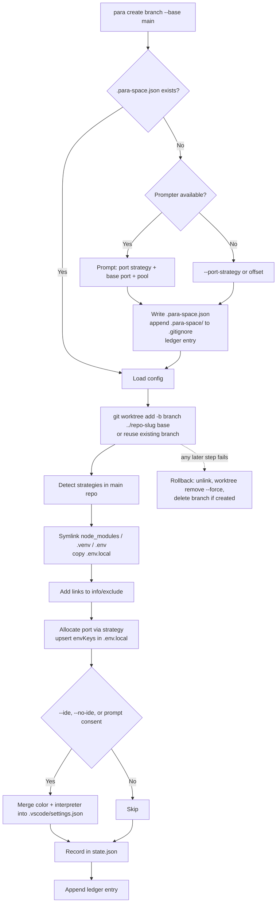
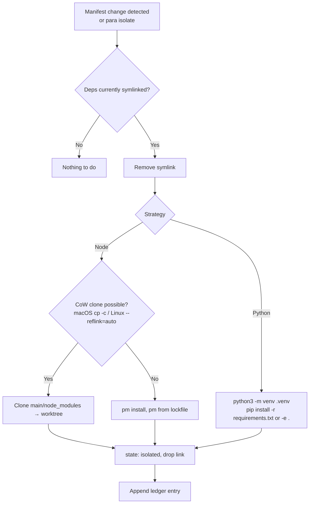

# ParaSpace — System Flows

How ParaSpace behaves, step by step, for each operation. This describes the **current intended** behavior; it is rewritten in place whenever behavior changes, while the reasons live in [DECISIONS.md](DECISIONS.md).

**How to update:** after any change that alters a flow, edit the affected section, bump its `Last updated` line, and reference the decision ID that caused it. Add a row to the changelog at the bottom.

Implementation status: §1–4 are **Implemented** (Phase 1: `packages/core` + `packages/cli`). §5 is Planned (Phase 2). The Phase 3 manifest watcher is Planned.

---

## 0. Component Map

```text
para CLI ──┐   packages/core/src/commands/        ┌── Git Engine            git.ts            (git worktree add/list/remove/prune)
 cli/src/   │   config.ts   (first-run setup)      ├── Framework Detector    frameworks/       (Node / Python / Env, kind: dependencies|config)
 commands/* ├─► create.ts   list.ts                ├── Dependency Linker     link.ts           (absolute symlinks, junctions, CoW clone)
 runtime.ts │   isolate.ts  remove.ts ─────────────┼── Port & Env Allocator  ports/, envfile.ts (offset / scan / pool / passthrough)
VS Code ext ┘   resolve.ts  (find worktree)        ├── Git ignore helper     ignore.ts         (info/exclude, .gitignore)
 (Phase 2)                                         ├── IDE Configurator      ide.ts, colors.ts (opt-in .vscode/settings.json)
                                                   ├── Context Logger        ledger.ts         (.para-space/context-history.md)
                                                   ├── State Store           state.ts          (~/.para-space/state.json)
                                                   └── util/                 exec, fs, format  (shared helpers)
```

Front-ends inject a Prompter; with none (agents, --yes, no TTY) core never prompts (D-020).
```

Files ParaSpace reads/writes:

| File | Scope | Purpose |
| :--- | :--- | :--- |
| `.para-space.json` | Repo (committed) | Port strategy, base port, env keys, optional `portPool` (D-004, D-014, D-015) |
| `.para-space/context-history.md` | Repo | Living decision ledger (D-007) |
| `~/.para-space/state.json` | Machine | Worktrees, index, ports, links, colors; atomic writes; `PARA_SPACE_HOME` overrides (D-010, D-022) |
| `<worktree>/.env` | Worktree | Symlink to main's `.env` (D-013) |
| `<worktree>/.env.local` | Worktree | Own copy of main's `.env.local` + assigned port(s) (D-013) |
| `$GIT_COMMON_DIR/info/exclude` | Repo (local) | Patterns that hide ParaSpace's links from git (D-019) |
| `.gitignore` | Repo | `.para-space/` appended on first run (D-014) |
| `<worktree>/.vscode/settings.json` | Worktree | Colors + interpreter path, only with consent (D-006) |

---

## 1. Create Worktree — `para create <branch> [--base <ref>]`
_Status: Implemented · Last updated: 2026-10-16 · Decisions: D-001, D-002, D-004, D-005, D-006, D-007, D-009, D-012–D-020, D-022_

Flags: `--port-strategy`, `--base-port`, `--port-pool` (first run only), `--ide` / `--no-ide`, `-r/--requirement <text>`, `-y/--yes`, `--json`.



1. Resolve the **main** repo root via `git rev-parse --git-common-dir` (works from inside any worktree). The target is `../<repo>-<slug>`, and it fails if that path already exists.
2. **First run:** if `.para-space.json` is missing, ask the Prompter. With no Prompter, use `--port-strategy` (default `offset`). `envKeys` = `PORT` plus strategy defaults (`VITE_PORT` for Vite). Append `.para-space/` to `.gitignore` and write a ledger entry.
3. `git worktree add -b <branch> <path> <base>`. If the branch already exists, it is checked out instead.
4. For each detected `FrameworkStrategy`, call `linkDependencies()`. Node links `node_modules` (skipped for Yarn PnP). Python links `.venv`. Env links `.env` and copies `.env.local`. Existing paths in the worktree (e.g. a tracked `.env`) are left alone.
5. Write root-anchored patterns for the links and `.env.local` to `$GIT_COMMON_DIR/info/exclude`.
6. `worktreeIndex` = lowest unused index ≥ 1. `assignedPorts` = ports in state + `basePort`. Write the result to every `envKeys` entry in the worktree's `.env.local` (skipped for `passthrough`).
7. IDE settings: Peacock colors for the index, plus `configureIdeSettings()` (Python interpreter path → `<worktree>/.venv/bin/python`). Written only with `--ide` or interactive consent, merged into the existing JSONC settings.
8. Record `{branch, path, index, port, color, links}` in state and append a ledger entry (the requirement comes from `--requirement`).
9. If steps 4–8 fail, roll back (D-022).

---

---

## 2. List Worktrees — `para list` (`ls`)
_Status: Implemented · Last updated: 2026-10-16 · Decisions: D-001, D-010_

1. `git worktree list --porcelain` is the source of truth for paths and branches.
2. Prune state entries whose worktree no longer exists, then merge state for port and color.
3. For each worktree, `git status --porcelain` → `Clean` or `N dirty`.
4. Deps mode (checks `node_modules` / `.venv`): `Source` (main repo), `Symlinked` (path is a link), `Isolated` (real directory), `None`.
5. Main's port = `basePort` (none for `passthrough`). Worktrees not created by para are tagged `(unmanaged)`.
6. Render the table (Name · Branch · Status · Port · Deps Mode), or `--json`.

Read-only apart from state pruning, so no ledger entry.

---

---

## 3. Isolate Dependencies — `para isolate <worktree> [-r <reason>]`
_Status: Command implemented (Phase 1); watcher planned (Phase 3) · Last updated: 2026-10-16 · Decisions: D-003, D-017_

`<worktree>` can be a branch name, a directory name or a path.



The `.env` link is never isolated, because it is config, not dependencies.

**Trigger (Phase 3):** a file watcher on `package.json`, lockfiles, `requirements.txt` and `pyproject.toml` in symlinked worktrees notifies the developer and offers Isolate.

---

---

## 4. Remove Worktree — `para remove <worktree> [-d/--delete-branch] [-f/--force]` (`rm`)
_Status: Implemented · Last updated: 2026-10-16 · Decisions: D-001, D-007, D-019_

1. Refuse if `git status` shows uncommitted changes, unless `--force`.
2. Unlink dependency symlinks **first**: those in the state record, plus any `node_modules` / `.venv` / `.env` link pointing into the main repo. Removal can never follow them into main.
3. `git worktree remove <path>` (`--force` with `-f`), then `git worktree prune`.
4. With `--delete-branch`: `git branch -d` (`-D` with `--force`). If it fails, the CLI warns and keeps the branch.
5. Remove the state entry, which frees the port and index for reuse.
6. Append a ledger entry.

---

---

## 5. VS Code Extension
_Status: Planned (Phase 2) · Last updated: 2026-10-16 · Decisions: D-006, D-008_

- **Activation:** read state + `git worktree list`; populate the ParaSpace sidebar tree view.
- **Tree item actions:** Open in New Window · Isolate Dependencies · Delete Worktree — each calls the same core functions as the CLI.
- **Status bar:** current worktree name + color; click opens a quick switcher.
- **Port strategy UI / history view:** edit `.para-space.json`, browse `context-history.md`.

---

## Changelog

| Date | Change | Sections | Decision |
| :--- | :--- | :--- | :--- |
| 2026-10-16 | Initial flows derived from PROJECT_PLAN.md | All | D-001 – D-010 |
| 2026-10-16 | Phase 1 implemented: create/list/isolate/remove flows updated with flags, info/exclude, env split, rollback, Python fresh venv, unlink-first remove | 0, 1, 2, 3, 4 | D-011 – D-022 |
| 2026-10-16 | Refactor, no behaviour change: orchestrator split into `core/src/commands/*` (one file per flow), CLI split into `cli/src/commands/*`, shared helpers moved to `util/`; strategies declare `kind` | 0 | D-023 |
| 2026-10-16 | Renamed ParallelTree → ParaSpace: CLI `para`, `.para-space.json`, `.para-space/`, `~/.para-space`, `PARA_SPACE_HOME` | All | D-026 |
