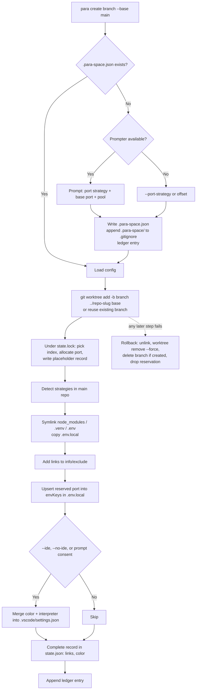
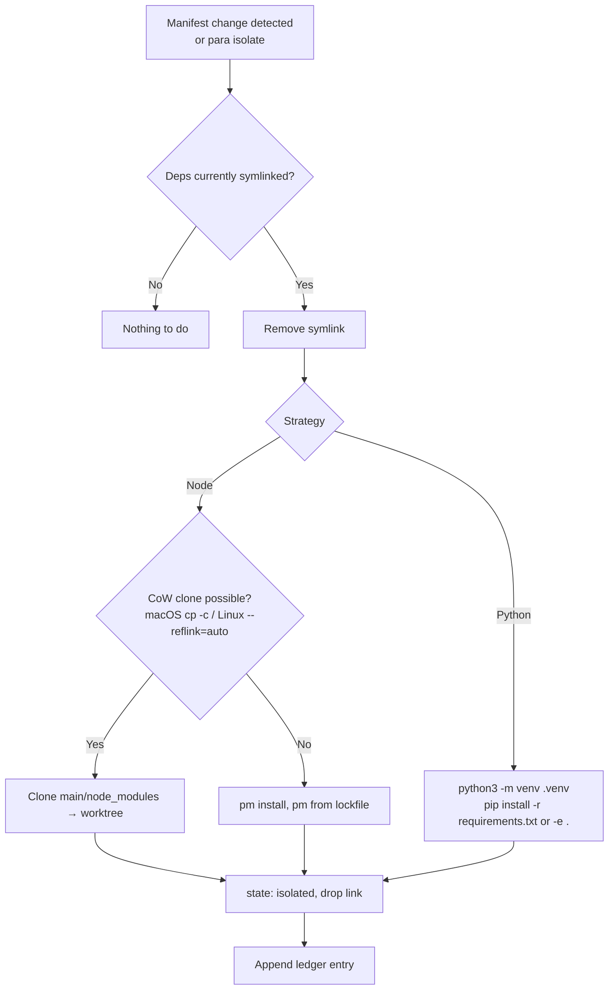

# ParaSpace — System Flows

How ParaSpace behaves, step by step, for each operation. This describes the **current intended** behavior; it is rewritten in place whenever behavior changes, while the reasons live in [DECISIONS.md](DECISIONS.md).

**How to update:** after any change that alters a flow, edit the affected section, bump its `Last updated` line, and reference the decision ID that caused it. Add a row to the changelog at the bottom.

Implementation status: §1–4 are **Implemented** (Phase 1: `packages/core` + `packages/cli`). §5 is In progress (Phase 2: `packages/vscode-extension`). The Phase 3 manifest watcher is Planned.

---

## 0. Component Map

```text
para CLI ──┐   packages/core/src/commands/        ┌── Git Engine            git.ts            (git worktree add/list/remove/prune)
 cli/src/   │   config.ts   (first-run setup)      ├── Framework Detector    frameworks/       (Node / Python / Env, kind: dependencies|config)
 commands/* ├─► create.ts   list.ts                ├── Dependency Linker     link.ts           (absolute symlinks, junctions, CoW clone)
 runtime.ts │   isolate.ts  remove.ts ─────────────┼── Port & Env Allocator  ports/, envfile.ts (offset / scan / pool / passthrough)
VS Code ext ┘   resolve.ts  (find worktree)        ├── Git ignore helper     ignore.ts         (info/exclude, .gitignore)
 vscode-extension/src/                             ├── IDE Configurator      ide.ts, colors.ts (opt-in .vscode/settings.json)
                                                   ├── Context Logger        ledger.ts         (.para-space/context-history.md)
                                                   ├── State Store           state.ts          (~/.para-space/state.json)
                                                   └── util/                 exec, fs, format, lock  (shared helpers; lock = state.lock)
```

Front-ends inject a Prompter; with none (agents, --yes, no TTY) core never prompts (D-020).
```

Files ParaSpace reads/writes:

| File | Scope | Purpose |
| :--- | :--- | :--- |
| `.para-space.json` | Repo (committed) | Port strategy, base port, env keys, optional `portPool` (D-004, D-014, D-015) |
| `.para-space/context-history.md` | Repo | Living decision ledger (D-007) |
| `~/.para-space/state.json` | Machine | Worktrees, index, ports, links, colors; atomic writes; `PARA_SPACE_HOME` overrides (D-010, D-022) |
| `<worktree>/.env` | Worktree | Symlink to main's `.env` (D-013) |
| `<worktree>/.env.local` | Worktree | Own copy of main's `.env.local` + assigned port(s) (D-013) |
| `$GIT_COMMON_DIR/info/exclude` | Repo (local) | Patterns that hide ParaSpace's links from git (D-019) |
| `.gitignore` | Repo | `.para-space/` appended on first run (D-014) |
| `<worktree>/.vscode/settings.json` | Worktree | Colors + interpreter path, only with consent (D-006) |

---

## 1. Create Worktree — `para create <branch> [--base <ref>]`
_Status: Implemented · Last updated: 2026-10-16 · Decisions: D-001, D-002, D-004, D-005, D-006, D-007, D-009, D-012–D-020, D-022, D-027_

Flags: `--port-strategy`, `--base-port`, `--port-pool` (first run only), `--ide` / `--no-ide`, `-r/--requirement <text>`, `-y/--yes`, `--json`.



1. Resolve the **main** repo root via `git rev-parse --git-common-dir` (works from inside any worktree). The target is `../<repo>-<slug>`, and it fails if that path already exists.
2. **First run:** if `.para-space.json` is missing, ask the Prompter. With no Prompter, use `--port-strategy` (default `offset`). `envKeys` = `PORT` plus strategy defaults (`VITE_PORT` for Vite). Append `.para-space/` to `.gitignore` and write a ledger entry.
3. `git worktree add -b <branch> <path> <base>`. If the branch already exists, it is checked out instead.
3a. **Reserve a slot (D-027):** while holding `~/.para-space/state.lock`, take `worktreeIndex` = lowest unused index ≥ 1, allocate a port (`assignedPorts` = ports in state + `basePort`), and write a placeholder record. Concurrent creates therefore never share an index or port. This happens after `git worktree add` so a concurrent `list` doesn't prune the placeholder.
4. For each detected `FrameworkStrategy`, call `linkDependencies()`. Node links `node_modules` (skipped for Yarn PnP). Python links `.venv`. Env links `.env` and copies `.env.local`. Existing paths in the worktree (e.g. a tracked `.env`) are left alone.
5. Write root-anchored patterns for the links and `.env.local` to `$GIT_COMMON_DIR/info/exclude`.
6. Write the reserved port to every `envKeys` entry in the worktree's `.env.local` (skipped for `passthrough`).
7. IDE settings: the index's palette color (D-034). The title bar and status bar get the color with white text; the inactive title bar and borders get its solid deeper shade; status bar hover gets its lighter shade; the activity bar keeps the theme and only gets a colored active marker and badge. Plus `configureIdeSettings()` (Python interpreter path → `<worktree>/.venv/bin/python`). Written only with `--ide` or interactive consent, merged into the existing JSONC settings.
8. Complete the reserved record with `links` and `color`, then append a ledger entry (the requirement comes from `--requirement`).
9. If steps 3a–8 fail, roll back (D-022), which also removes the reservation.

Every state write (create, isolate, remove, list's prune) goes through `updateRepoState`, which holds `state.lock` for the whole read-modify-write. Waiters retry for up to 10 s. A lock whose process is dead, or that is older than 30 s, is reclaimed (D-027).

---

---

## 2. List Worktrees — `para list` (`ls`)
_Status: Implemented · Last updated: 2026-10-17 · Decisions: D-001, D-010, D-031_

1. `git worktree list --porcelain` is the source of truth for paths and branches.
2. Read state (no lock). Only if some entry's worktree no longer exists, prune it under the state lock. Otherwise `state.json` isn't written (D-031). Then merge state for port and color.
3. For each worktree, `git status --porcelain` → `Clean` or `N dirty`.
4. Deps mode (checks `node_modules` / `.venv`): `Source` (main repo), `Symlinked` (path is a link), `Isolated` (real directory), `None`.
5. Main's port = `basePort` (none for `passthrough`). Worktrees not created by para are tagged `(unmanaged)`.
6. Render the table (Name · Branch · Status · Port · Deps Mode), or `--json`.

Read-only apart from state pruning, so no ledger entry.

---

---

## 3. Isolate Dependencies — `para isolate <worktree> [-r <reason>]`
_Status: Command implemented (Phase 1); watcher planned (Phase 3) · Last updated: 2026-10-16 · Decisions: D-003, D-017_

`<worktree>` can be a branch name, a directory name or a path.



The `.env` link is never isolated, because it is config, not dependencies.

**Trigger (Phase 3):** a file watcher on `package.json`, lockfiles, `requirements.txt` and `pyproject.toml` in symlinked worktrees notifies the developer and offers Isolate.

---

---

## 4. Remove Worktree — `para remove <worktree> [-d/--delete-branch] [-f/--force]` (`rm`)
_Status: Implemented · Last updated: 2026-10-16 · Decisions: D-001, D-007, D-019_

1. Refuse if `git status` shows uncommitted changes, unless `--force`.
2. Unlink dependency symlinks **first**: those in the state record, plus any `node_modules` / `.venv` / `.env` link pointing into the main repo. Removal can never follow them into main.
3. `git worktree remove <path>` (`--force` with `-f`), then `git worktree prune`.
4. With `--delete-branch`: `git branch -d` (`-D` with `--force`). If it fails, the CLI warns and keeps the branch.
5. Remove the state entry, which frees the port and index for reuse.
6. Append a ledger entry.

---

---

## 5. VS Code Extension
_Status: In progress (Phase 2): sidebar tree view with Create / Open / Isolate / Remove, first-run port strategy dialogs, status bar and worktree switcher implemented; ledger view and port strategy editing planned · Last updated: 2026-10-17 · Decisions: D-006, D-008, D-020, D-030, D-031, D-032, D-033_

**Implemented:**
- **Activation:** `onStartupFinished`, so the status bar appears without opening the view. `activate()` creates the `ParaSpace` output channel (core's `Logger`), the `WorktreeStore`, the tree view, the status bar, the commands and the change watchers, then loads the store once.
- **WorktreeStore** (D-033): the only caller of `listWorktrees` in the extension. `load()` records the repo root, rows and any error, then fires `onDidChange`. A load requested while one is running causes exactly one more load afterwards. The tree and status bar render from it, and commands call `store.load()` after a change. `current` is the row containing the window's folder, with the deepest match winning.
- **Which repo:** the workspace folder of the active editor, else the first workspace folder.
- **Sidebar** (activity bar container `paraSpace`, view `paraSpace.worktrees`): one flat row per worktree from core's `listWorktrees()`. Icon `repo` for main, `git-branch` for others. Description: branch · clean/dirty · port · deps mode (· unmanaged). Tooltip: path, branch, status, port, deps. With no folder open, a welcome message offers Open Folder. If listing fails, the error is shown above the empty tree and logged.
- **Refresh:** the title-bar ↻ button (`paraSpace.refresh`), plus automatic, debounced (300 ms) store reloads when:
  - `~/.para-space/state.json` is created, changed or deleted (CLI or agent runs),
  - workspace folders change,
  - the window regains focus (covers plain `git worktree` commands),
  - the active editor moves to a different repo (multi-root).
  Listing doesn't write `state.json` unless it prunes, so refreshes don't trigger themselves (D-031).
- **Current worktree marker:** in the tree, the current worktree's row has a ✓ icon.
- **Status bar** (left side):
  - `$(git-branch) <branch> · :<port>`, or `$(repo) <branch>` for the main repo.
  - Preceded by a ● dot in the worktree's ParaSpace color, when it has one.
  - The tooltip shows path, branch, status, port and deps. Clicking opens the switcher.
  - Hidden when the window's folder is not in a git repo.
- **Open in New Window** (`paraSpace.openInNewWindow`): inline button and context-menu item on every row. Opens the worktree with `vscode.openFolder` and `forceNewWindow`. Hidden from the Command Palette because it needs a row.
- **`ParaSpace: List Worktrees`** (`paraSpace.listWorktrees`, the switcher; also opened from the status bar): reloads the store, then shows a quick pick.
  - The first row is **Create Worktree…**, which runs `paraSpace.createWorktree`.
  - Then every worktree, the current one marked ✓ and `current`.
  - Picking another worktree opens it in a new window; picking the current one does nothing.
- **Create Worktree…** (`paraSpace.createWorktree`, the **+** in the view title, also in the Command Palette):
  1. Input: branch name, validated in the box (no spaces, no `..`, `~ ^ : ? * [ \`, no leading `-`, no trailing `/` or `.lock`).
  2. If the branch doesn't exist yet: quick pick of the base from `listBranches()` (most recent first). An existing branch skips this step.
  3. Input: optional reason, recorded as the ledger's requirement.
  4. `createWorktree` runs behind a progress notification, with `vscodePrompter` as the prompter and `ide: 'ask'`.
     - First run in the repo: a port strategy quick pick, then base port and pool inputs as needed.
     - IDE colors: a modal confirm. Dismissing it means "no", because the worktree already exists by then.
  5. The tree refreshes, and a notification shows the name and port with an **Open in New Window** button.
  - Escape on any prompt cancels quietly; nothing has been created at that point. A failure after the checkout rolls back as in §1.
- **Isolate Dependencies…** (`paraSpace.isolateWorktree`, right-click on a worktree whose deps are still `Symlinked`, contextValue `worktree.linked.shared`):
  - A modal confirm explains the copy or install, then an optional reason is asked.
  - `isolateWorktree` runs with progress. The result names the isolated strategies, or says there was nothing to isolate.
- **Remove Worktree…** (`paraSpace.removeWorktree`, right-click on any non-main worktree):
  - Refused if this window has that worktree open.
  - A modal confirm with **Remove** / **Remove and Delete Branch**. A dirty worktree gets only **Force Remove** variants, and the detail says how many changes will be lost and that unmerged commits go with the branch.
  - `removeWorktree` runs with progress. If a branch delete was asked for but the branch wasn't merged (non-force), a warning says the branch was kept.
- **Errors:** command errors are written to the output channel and shown as a notification. A dismissed prompt (`CancelledError`) is not an error.
- Row actions (Open, Isolate, Remove) are hidden from the Command Palette because they need a row.
- **Port strategy UI / history view:** edit `.para-space.json`, browse `context-history.md`.

---

## Changelog

| Date | Change | Sections | Decision |
| :--- | :--- | :--- | :--- |
| 2026-10-16 | Initial flows derived from PROJECT_PLAN.md | All | D-001 – D-010 |
| 2026-10-16 | Phase 1 implemented: create/list/isolate/remove flows updated with flags, info/exclude, env split, rollback, Python fresh venv, unlink-first remove | 0, 1, 2, 3, 4 | D-011 – D-022 |
| 2026-10-16 | Refactor, no behaviour change: orchestrator split into `core/src/commands/*` (one file per flow), CLI split into `cli/src/commands/*`, shared helpers moved to `util/`; strategies declare `kind` | 0 | D-023 |
| 2026-10-16 | Renamed ParallelTree → ParaSpace: CLI `para`, `.para-space.json`, `.para-space/`, `~/.para-space`, `PARA_SPACE_HOME` | All | D-026 |
| 2026-10-16 | State writes serialized by `~/.para-space/state.lock`; `create` reserves index and port under the lock right after `git worktree add`, and rollback drops the reservation | 0, 1 | D-027 |
| 2026-10-17 | VS Code extension scaffolded (`packages/vscode-extension`): activation, output-channel logger, `ParaSpace: List Worktrees` quick pick that opens the chosen worktree in a new window | 0, 5 | D-030 |
| 2026-10-17 | Sidebar tree view with refresh button, auto-refresh (state.json watcher, folder changes, window focus) and Open in New Window; `list` writes state only when pruning | 2, 5 | D-031 |
| 2026-10-17 | Extension gains Create / Isolate / Remove (dialogs, progress, force-on-dirty, refuse removing the open worktree) and `vscodePrompter`; core gains `listBranches()` and shared `PORT_STRATEGY_CHOICES` | 5 | D-032 |
| 2026-10-17 | Status bar (color dot + branch · port) and worktree switcher (Create first, current marked); `WorktreeStore` shared by tree and status bar; activation on startup; reload when the active editor changes repo | 5 | D-033 |
| 2026-10-17 | New window palette (Graphite + 7 equal-lightness OKLCH colors, WCAG AA with white text); title and status bars colored, activity bar left to the theme, solid inactive title bar | 1 | D-034 |
