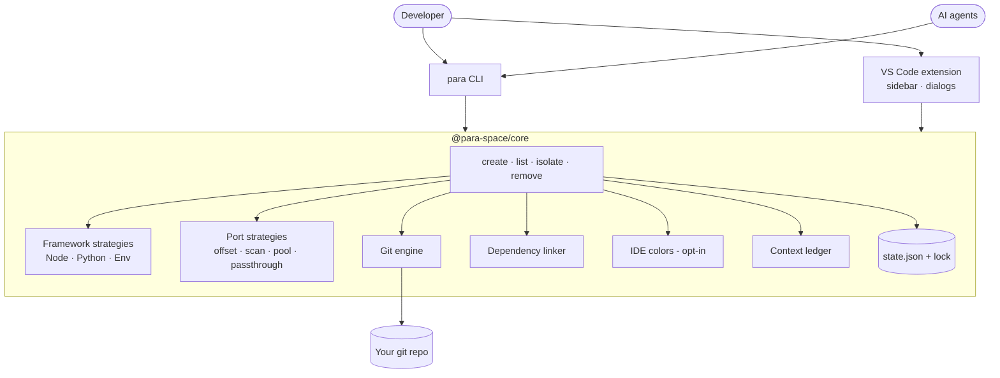
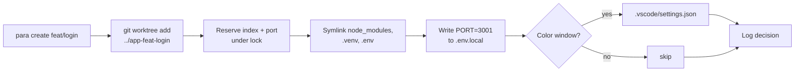
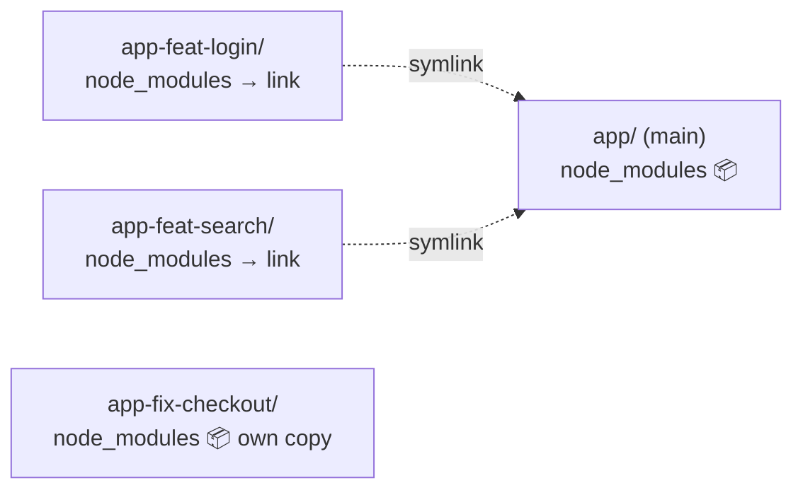

# ParaSpace — Visual Brief

Context for generating images, diagrams and social posts about ParaSpace with AI tools. Paste the sections you need into the tool. Everything here matches the code as of 2026-10-17; anything not built yet is marked **(planned)**. Don't show planned features as finished.

---

## 1. The one-liner

**ParaSpace runs several copies of your project side by side — one per branch, task or AI agent — without reinstalling dependencies, fighting over ports, or confusing your editor windows.**

Short tagline options:
- "Parallel workspaces for parallel work."
- "One repo. Many branches. Zero reinstalls."
- "Give every AI agent its own desk."

## 2. The problem (the "before" picture)

A developer, or several AI coding agents, wants to work on multiple branches of the same app at the same time.

- **Switching branches** in one folder means stashing work, and every dev server restarts.
- **Cloning the repo again** means another `npm install` (hundreds of MB, minutes of waiting) per copy.
- **Two dev servers** both try to use port 3000. One crashes.
- **Five identical VS Code windows**: which one is the hotfix and which is the feature?
- **AI agents** working in parallel overwrite each other's files.

Visual metaphor: one cluttered desk where five people try to work on the same sheet of paper.

## 3. The solution (the "after" picture)

ParaSpace creates a **git worktree** per task: a second working folder that shares the same git history. Then for each one it:

1. **Shares dependencies.** `node_modules` and `.venv` are *symlinked* to the main copy. No reinstall, no extra disk space.
2. **Gives each worktree its own port.** Main gets 3000, worktree 1 gets 3001, worktree 2 gets 3002… The port is written into that worktree's `.env.local`.
3. **Colors each editor window** (opt-in). Each worktree's VS Code window gets its own title-bar and status-bar color.
4. **Lets you break away safely.** "Isolate" gives one worktree its own copy of the dependencies before you upgrade a package, so the main copy is never touched.
5. **Keeps a decision log.** Every action appends a "why" entry to `.para-space/context-history.md`.

Visual metaphor: an open-plan office of identical, color-coded desks, each with its own phone line (port), all drawing from one shared supply cabinet (dependencies).

## 4. How people use it

| Front end | Status | What it looks like |
| :--- | :--- | :--- |
| **CLI `para`** | Built | `para create feat/login --base main`, `para list`, `para isolate`, `para remove` |
| **VS Code extension** | Built (Phase 2, in progress) | A "ParaSpace" icon in the activity bar → **Worktrees** sidebar: one row per worktree (branch · clean/dirty · port · deps mode), the current one checked, a **+** button to create, right-click to isolate or remove, a button to open in a new window. The list auto-refreshes. |
| Status bar + quick switcher | Built | Bottom-left: a dot in the worktree's color + `feat/login · :3001`; click to open a switcher listing every worktree (current one checked) with "Create Worktree…" on top |
| Ledger viewer | **(planned)** | Browse the decision history inside VS Code |
| File watchers | **(planned, Phase 3)** | Warn when `package.json` changes in a worktree that shares deps |

Example `para list` output (real format):

```
┌──────────────────┬─────────────┬──────────┬──────┬───────────┐
│ Name             │ Branch      │ Status   │ Port │ Deps Mode │
├──────────────────┼─────────────┼──────────┼──────┼───────────┤
│ (main)           │ main        │ Clean    │ 3000 │ Source    │
│ app-feat-login   │ feat/login  │ 2 dirty  │ 3001 │ Symlinked │
│ app-fix-checkout │ fix/checkout│ Clean    │ 3002 │ Isolated  │
└──────────────────┴─────────────┴──────────┴──────┴───────────┘
```

## 5. Architecture

Three packages in one TypeScript monorepo (pnpm workspaces):

```
                ┌──────────────┐     ┌──────────────────────┐
  Developer ───►│  para CLI    │     │ VS Code extension    │◄─── Developer
  AI agent  ───►│ (terminal)   │     │ (sidebar, dialogs)   │
                └──────┬───────┘     └──────────┬───────────┘
                       │  same function calls   │
                       ▼                        ▼
        ┌───────────────────────────────────────────────────────┐
        │                 @para-space/core (engine)             │
        │  commands: create · list · isolate · remove · config  │
        │                                                       │
        │  Framework strategies   Port strategies   Git engine  │
        │  Node · Python · Env    offset · scan ·   worktree    │
        │                         pool · passthrough add/remove │
        │                                                       │
        │  Dependency linker   IDE colors   Context ledger      │
        │  (symlinks)          (opt-in)     (decision log)      │
        │                                                       │
        │  State store  ~/.para-space/state.json  + file lock   │
        └───────────────────────────────────────────────────────┘
                       │
                       ▼
        Your repo:   app/  (main)        app-feat-login/   app-fix-checkout/
                     node_modules ◄──────── symlink           own copy (isolated)
                     port 3000              port 3001         port 3002
```

Key architecture ideas worth showing:
- **One engine, many front ends.** The CLI and the extension are thin layers over the same core. The core never prompts or prints; the front end passes in its own "prompter" (terminal questions or VS Code dialogs). This is why AI agents can drive it non-interactively.
- **Strategy pattern (plugins).** Each ecosystem (Node, Python, env files) and each port rule (offset, scan, pool, passthrough) is a small plug-in behind one interface. Adding Rust or Go means adding one file.
- **Safe concurrency.** Several agents can create worktrees at the same moment. A lock file serializes state changes so no two get the same port.
- **Git is the source of truth.** ParaSpace's state only adds ports and colors on top of `git worktree list`.

## 6. Ready-to-render diagrams (Mermaid)

These are exact, so prefer them over AI-drawn diagrams for anything technical. They render on GitHub, in Notion, at mermaid.live, and in many slide tools.

**Architecture**



**What `create` does**



**Shared vs isolated dependencies**



## 7. Visual identity

**Worktree colors** (the real palette used for window colors; index 0 is the main repo). All share the same perceived lightness, so they read as one family: muted jewel tones, never neon.

| # | Name | Hex | Deeper shade | Character |
| :--- | :--- | :--- | :--- | :--- |
| 0 (main) | Graphite | `#414853` | `#30363f` | neutral anchor, the "source" |
| 1 | Lagoon | `#137d87` | `#006871` | deep sea teal |
| 2 | Coral | `#be414a` | `#a32f39` | warm red-coral |
| 3 | Violet | `#7855c3` | `#6442a8` | soft ultraviolet |
| 4 | Ochre | `#9e6414` | `#875100` | burnt gold |
| 5 | Cobalt | `#2d6fbe` | `#1c5aa3` | clear blue |
| 6 | Jade | `#34814e` | `#216b3c` | forest jade |
| 7 | Orchid | `#a5478e` | `#8c3578` | dusty magenta |

- **Mood:** calm, organized, developer-tool. Dark editor backgrounds, crisp lines, flat or isometric style. Think "air-traffic control for code", not "hacker in a hoodie".
- **Recurring motifs:** parallel lanes or tracks, branching lines (git branches), color-coded windows or desks, one shared graphite source feeding several copies, port numbers as small labels (3000, 3001, 3002).
- **Logo idea:** three parallel branch lines coming from one graphite root dot, in Lagoon, Coral and Violet.
- **Avoid:** fake brand logos (GitHub, VS Code, OpenAI marks), garbled code text, extra features not listed here.

## 8. Image prompts (copy-paste)

Image generators render text badly. Keep the text in the image short, or add labels afterwards.

1. **Hero / banner**
   > Isometric illustration of a dark-themed developer workspace: one central glowing cube labeled "main" feeding thin light beams into four identical floating code editor windows arranged in parallel lanes. Each window has a different colored title bar (lagoon teal #137d87, coral #be414a, violet #7855c3, cobalt blue #2d6fbe) and a small badge with a port number (3001, 3002, 3003, 3004). Clean flat vector style, deep navy background, soft glow, minimal, no logos, 16:9.

2. **Before / after**
   > Split-screen illustration. Left side "Before": a single cluttered desk where five small robots fight over one laptop, papers flying, a red "port 3000 in use" warning. Right side "After": five tidy color-coded desks in a row, each robot calmly working on its own laptop, all connected by thin pipes to one shared supply cabinet in the center. Flat vector, friendly, muted dark palette with lagoon teal, coral, violet, ochre and jade accents (equal brightness, jewel tones), no text except the two headings.

3. **AI agents in parallel**
   > Top-down view of an air-traffic-control style dashboard on a dark background showing five parallel glowing lanes, each lane a git branch line with a small robot icon and a colored tag (lagoon teal, coral, violet, ochre, jade), all lanes starting from one graphite-grey root node. Minimal, technical, elegant, vector style, no logos.

4. **Dependency sharing concept**
   > Conceptual diagram-style illustration: one large graphite-grey box of building blocks (dependencies) in the middle, with dotted lines linking it to three smaller transparent workspace boxes; a fourth workspace box sits slightly apart with its own copy of the blocks, highlighted in ochre gold #9e6414 to show "isolated". Clean white or dark background, flat, isometric, no text.

5. **Social card (square)**
   > Square 1:1 social media card, dark navy background, three parallel curved lines in lagoon teal #137d87, coral #be414a and violet #7855c3 branching from one graphite dot on the left and running to the right, subtle grid, plenty of empty space at the top for a headline. Minimal, modern, vector.

## 9. Post-ready copy

**Short (X / Threads)**
> Working on 3 branches at once used to mean 3 × `npm install`, a port clash, and five identical VS Code windows.
> ParaSpace: git worktrees that share deps via symlinks, get their own port, and get their own window color. Built for parallel AI agents too.

**LinkedIn (longer)**
> AI coding agents are great until you run three of them on the same repo.
> They overwrite each other's files, two dev servers fight over port 3000, and every fresh clone needs another `npm install`.
>
> I'm building ParaSpace to fix that:
> • one git worktree per task, so agents never share files
> • dependencies shared through symlinks: no reinstall, no extra disk
> • a unique dev port per worktree, written to `.env.local`
> • color-coded VS Code windows so you always know where you are
> • one engine behind both a CLI and a VS Code extension, safe for agents running in parallel
>
> Every VS Code window also shows which worktree it is in the status bar, and switching takes two clicks.
> Next up: a decision-history view and file watchers that warn before a shared dependency changes.

## 10. Glossary (keep wording consistent)

| Term | Meaning |
| :--- | :--- |
| Worktree | An extra working folder of the same git repo, checked out on another branch |
| Main repo | The original folder; its dependencies are the shared "source" |
| Symlinked / shared | The worktree uses the main repo's `node_modules` / `.venv` through a link |
| Isolated | The worktree has its own copy of the dependencies |
| Port strategy | The rule for picking each worktree's dev-server port |
| Context ledger | The running log of what was done and why |
