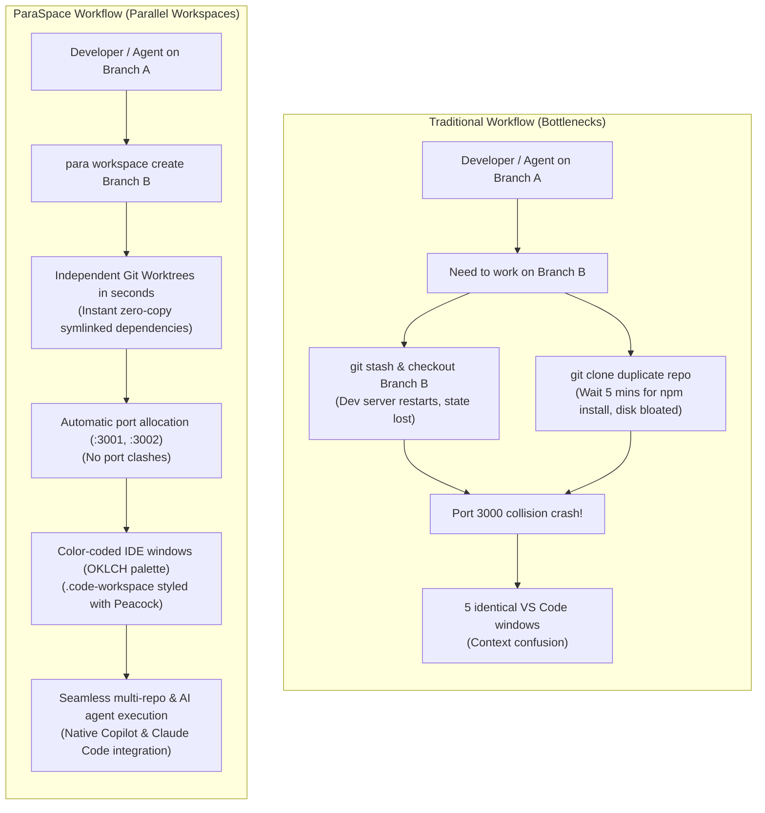
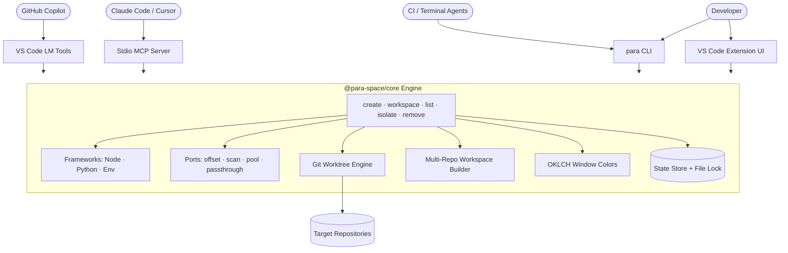
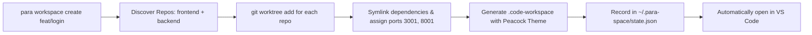

# ParaSpace — Visual Brief

Context for generating images, diagrams and social posts about ParaSpace with AI tools. Paste the sections you need into the tool. Everything here matches the code as of 2026-10-22; anything not built yet is marked **(planned)**. Don't show planned features as finished.

---

## 1. The one-liner

**ParaSpace runs several copies of your project side by side — one per branch, task or AI agent — without reinstalling dependencies, fighting over ports, or confusing your editor windows.**

Short tagline options:
- "Parallel workspaces for parallel work."
- "One repo. Many branches. Zero reinstalls."
- "Give every AI agent its own desk."
- "Multi-repo parallel workspaces with zero-copy dependencies."

## 2. Workflow Comparison: Old vs. New with ParaSpace

| Aspect | Previous / Traditional Workflow | New Workflow with ParaSpace |
| :--- | :--- | :--- |
| **Branch Switching** | `git stash` → `git checkout` → dev servers crash and must restart → state and uncommitted work lost. | **Zero interruptions:** Each task gets its own Git worktree directory (`../<repo>-<branch>`). Work simultaneously across 5 branches. |
| **Multiple Checkouts / Clones** | `git clone` duplicates gigabytes of `.git` object history, decouples branch refs, and desynchronizes remotes. | **Zero-duplication worktrees:** Uses `git worktree add` connected to the same local Git database. Instant checkouts, shared ref log. |
| **Dependencies & Disk Space** | Running `npm install` or recreating `.venv` per clone takes 2–10 minutes and hundreds of megabytes each. | **Zero-copy symlinks:** Dependencies (`node_modules`, `.venv`) and `.env` are shared via absolute symlinks in milliseconds. Zero extra disk. |
| **Dependency Divergence & Upgrades** | Modifying packages in one clone breaks running dev servers across other branches. | **Breakaway Isolation:** ParaSpace watches package manifests. If packages diverge, 1-click **Isolate** performs instant APFS CoW clone (macOS) or local install. |
| **Dev Server Ports** | Two concurrent servers crash fighting over port 3000 (`EADDRINUSE`). | **Automatic Port Strategy:** ParaSpace assigns offset ports (3000, 3001, 3002...) via `.env.local` automatically without port collisions. |
| **Multi-Repo Projects (Frontend + Backend)** | Manually opening separate terminal tabs and IDE windows for frontend, backend, and API repositories. | **Unified Multi-Repo Workspaces:** One command provisions worktrees across all member repos, generates a `.code-workspace` file, and opens them together. |
| **Window Identity & Context Loss** | Five identical, indistinguishable IDE windows. Easy to make edits in the wrong branch window. | **Equal-Lightness OKLCH Peacock Theme:** Each window gets an accent color (Lagoon, Coral, Violet, Ochre...) in title, status, and `.code-workspace`. |
| **AI Coding Agents (Copilot, Claude, Cursor)** | Agents collide on files, hang on terminal prompts, and force committing `.github/` or `CLAUDE.md` files into every repo. | **3-Tier Zero-Config Integration:** Native VS Code Language Model Tools, built-in MCP server (`para mcp`), `para setup-agent`, and headless `--yes` `--json` flags. No repo files required. |
| **Context & Decisions** | Ticket context and reasoning get lost across git branch switches. | **Living Context Ledger:** Every creation, configuration shift, or isolation appends structured records to `.para-space/context-history.md`. |

---

## 3. The problem (the "before" picture)

A developer, or several AI coding agents, wants to work on multiple branches of the same app at the same time.

- **Switching branches** in one folder means stashing work, and every dev server restarts.
- **Cloning the repo again** means another `npm install` (hundreds of MB, minutes of waiting) per copy.
- **Two dev servers** both try to use port 3000. One crashes.
- **Five identical VS Code windows**: which one is the hotfix and which is the feature?
- **Multi-repo stacks** (frontend + backend) multiply the confusion by requiring coordinated branch switches across multiple repos.
- **AI agents** working in parallel overwrite each other's files or hang waiting for interactive input.

Visual metaphor: one cluttered desk where five people try to work on the same sheet of paper.

## 4. The solution (the "after" picture)

ParaSpace creates a **git worktree** (or multi-repo `.code-workspace`) per task: an independent working folder sharing the same git history. Then for each one it:

1. **Shares dependencies.** `node_modules` and `.venv` are *symlinked* to the main copy. No reinstall, no extra disk space.
2. **Gives each worktree its own port.** Main gets 3000, worktree 1 gets 3001, worktree 2 gets 3002… The port is written into that worktree's `.env.local`.
3. **Colors each editor window.** Each worktree or multi-repo workspace receives its own title-bar and status-bar color (Lagoon, Coral, Violet, Ochre...).
4. **Lets you break away safely.** "Isolate" gives one worktree its own copy of the dependencies before you upgrade a package, so the main copy is never touched.
5. **Multi-Repo parallel workspaces.** Provisions parallel worktrees across all workspace repositories, generates a `.code-workspace` file, and opens it automatically in a new window.
6. **Zero-Config Agent integration.** AI agents (Copilot, Claude Code, Cursor) interact natively via Language Model Tools and MCP without modifying project repos.
7. **Keeps a decision log.** Every action appends a "why" entry to `.para-space/context-history.md`.

Visual metaphor: an open-plan office of identical, color-coded desks, each with its own phone line (port), all drawing from one shared supply cabinet (dependencies).

## 5. How people and AI agents use it

| Front end / Interface | Status | What it looks like |
| :--- | :--- | :--- |
| **CLI `para`** | Built | `para create <branch>`, `para workspace create <branch>`, `para workspace open <target>`, `para workspace list`, `para list`, `para isolate`, `para remove` |
| **VS Code extension** | Built | Activity bar icon → **Worktrees** view: lists multi-repo workspaces and per-repo worktrees (branch · clean/dirty · port · deps mode), 1-click **Open in New Window**, **+** button to create with searchable branch picker. |
| **Context History view** | Built | **Context History** sidebar view: interactive tree of decision ledger entries (`.para-space/context-history.md`) with Requirement, Decisions, and Problem Solved. |
| **Status bar + quick switcher** | Built | Bottom-left: dot in worktree color + `feat/login · :3001`; click to open a switcher listing multi-repo workspaces and worktrees (current checked). |
| **VS Code LM Tools (Copilot)** | Built | Zero-config native tools for GitHub Copilot Chat: `para_create_workspace`, `para_open_workspace`, `para_list_worktrees`, `para_isolate_worktree`. |
| **MCP Server (`para mcp`)** | Built | Stdio Model Context Protocol server for Claude Code, Cursor, Windsurf, and Claude Desktop. Auto-configured with `para setup-agent`. |
| **Manifest Watchers** | Built | Monitors `package.json` / lockfiles; notifies developer with 1-click breakaway **Isolate Dependencies** if manifests diverge. |

Example `para list` output (real format):

```
┌──────────────────┬─────────────┬──────────┬──────┬───────────┐
│ Name             │ Branch      │ Status   │ Port │ Deps Mode │
├──────────────────┼─────────────┼──────────┼──────┼───────────┤
│ (main)           │ main        │ Clean    │ 3000 │ Source    │
│ app-feat-login   │ feat/login  │ 2 dirty  │ 3001 │ Symlinked │
│ app-fix-checkout │ fix/checkout│ Clean    │ 3002 │ Isolated  │
└──────────────────┴─────────────┴──────────┴──────┴───────────┘
```

Example `para workspace list` output:

```
✔ Found 2 workspace(s):

  Untitled-feat-TRI-7402 (feature/tri-7402-request-a-visa)
    file: /Users/sarthak/Desktop/Tripare/Untitled-feat-TRI-7402.code-workspace
    repos: Business-Travel-Booking-Dashboard (...), tp-api (...)
```

## 6. Architecture

Three packages in one TypeScript monorepo (pnpm workspaces):

```
┌────────────────────────────────────────────────────────────────────────┐
│                        AI CODING AGENTS & DEVELOPERS                   │
│   GitHub Copilot  │  Claude Code  │  Cursor  │  Windsurf  │  Developer │
└─────────┬──────────────────┬─────────────────────┬──────────────┬──────┘
          │                  │                     │              │
          ▼                  ▼                     ▼              ▼
┌──────────────────┐ ┌───────────────┐ ┌───────────────────┐ ┌───────────┐
│ VS Code LM Tools │ │ Stdio MCP     │ │ Headless CLI      │ │ VS Code   │
│ Extension API    │ │ Server (`mcp`)│ │ (`--yes` `--json`)│ │ UI Sidebar│
└─────────┬────────┘ └───────┬───────┘ └───────────┬───────┘ └─────┬─────┘
          │                  │                     │               │
          └──────────────────┼─────────────────────┴───────────────┘
                             ▼
        ┌─────────────────────────────────────────────────────────┐
        │                 @para-space/core (engine)               │
        │  commands: create · workspace · list · isolate · remove │
        │                                                         │
        │  Framework strategies    Port strategies   Git engine   │
        │  Node · Python · Env     offset · scan ·   worktrees    │
        │                          pool · passthrough add/list    │
        │                                                         │
        │  Workspace engine        IDE colors        Ledger       │
        │  (.code-workspace)       (OKLCH palette)   (context)    │
        │                                                         │
        │  State store  ~/.para-space/state.json + file lock      │
        └────────────────────────────┬────────────────────────────┘
                                     │
                                     ▼
        Multi-Repo:  frontend/ (main)         frontend-feat-login/ (worktree)
                     backend/ (main)          backend-feat-login/ (worktree)
                     port 3000, 8000          port 3001, 8001
                     Shared node_modules      login.code-workspace (Peacock Violet)
```

Key architecture ideas worth showing:
- **One engine, many front ends.** The CLI, extension UI, VS Code LM Tools, and MCP server are thin layers over `@para-space/core`.
- **Zero-Config Agent integration.** AI agents discover and use tools via VS Code's Language Model API or global MCP configs (`para setup-agent`) without committing instructions to user repos.
- **Unified Multi-Repository Workspaces.** Multi-root projects generate a `.code-workspace` file pointing to parallel worktrees across all member repositories.
- **Safe concurrency.** Several agents can create worktrees at the same moment. A file lock serializes state changes so no two get the same port or index.
- **Git is the source of truth.** ParaSpace's state only adds ports, colors, and workspace links on top of `git worktree list`.

---

## 7. Ready-to-render diagrams (Mermaid)

These are exact, so prefer them over AI-drawn diagrams for anything technical. They render on GitHub, in Notion, at mermaid.live, and in many slide tools.

**Workflow Comparison: Before vs. After**



**Architecture Overview**



**Multi-Repo Workspace Provisioning**



---

## 8. Visual identity

**Worktree colors** (the real palette used for window colors; index 0 is the main repo). All share the same perceived lightness, so they read as one family: muted jewel tones, never neon.

| # | Name | Hex | Deeper shade | Character |
| :--- | :--- | :--- | :--- | :--- |
| 0 (main) | Graphite | `#414853` | `#30363f` | neutral anchor, the "source" |
| 1 | Lagoon | `#137d87` | `#006871` | deep sea teal |
| 2 | Coral | `#be414a` | `#a32f39` | warm red-coral |
| 3 | Violet | `#7855c3` | `#6442a8` | soft ultraviolet |
| 4 | Ochre | `#9e6414` | `#875100` | burnt gold |
| 5 | Cobalt | `#2d6fbe` | `#1c5aa3` | clear blue |
| 6 | Jade | `#34814e` | `#216b3c` | forest jade |
| 7 | Orchid | `#a5478e` | `#8c3578` | dusty magenta |

- **Mood:** calm, organized, developer-tool. Dark editor backgrounds, crisp lines, flat or isometric style. Think "air-traffic control for code", not "hacker in a hoodie".
- **Recurring motifs:** parallel lanes or tracks, branching lines (git branches), color-coded windows or desks, one shared graphite source feeding several copies, port numbers as small labels (3000, 3001, 3002).
- **Logo idea:** three parallel branch lines coming from one graphite root dot, in Lagoon, Coral and Violet.
- **Avoid:** fake brand logos (GitHub, VS Code, OpenAI marks), garbled code text, extra features not listed here.

## 9. Image prompts (copy-paste)

Image generators render text badly. Keep the text in the image short, or add labels afterwards.

1. **Hero / banner: Multi-Repo Parallel Workspaces**
   > Isometric illustration of a dark-themed modern developer workspace: two central glowing code cubes labeled "frontend" and "backend" feeding thin light beams into four floating multi-window code editor stations arranged in parallel lanes. Each station has a distinct color-coded window frame (lagoon teal #137d87, coral #be414a, violet #7855c3, cobalt blue #2d6fbe) with small badges indicating assigned ports (3001, 8001). Clean flat vector style, deep navy background, soft ambient glow, minimal, developer aesthetic, 16:9.

2. **Before / after: The Workflow Shift**
   > Split-screen technical illustration. Left side "Before": a single cluttered desk where three AI robots fight over one laptop, cables tangled, red warning icon "Port 3000 in use", stack of "npm install" loading bars. Right side "After": three neat parallel desks in a row, each robot calmly working with its own color-coded laptop (teal, coral, violet), thin neat pipes connected to one central shared dependency hub. Flat vector, clean modern aesthetic, dark navy background.

3. **AI agents in parallel: The Air-Traffic Control Metaphor**
   > High-tech top-down air-traffic-control dashboard on dark slate background showing multiple parallel glowing tracks. On each track, a small futuristic robot avatar navigates an independent branch lane marked with a colorful badge (Lagoon Teal, Coral Red, Violet, Ochre). All tracks cleanly branch from a central graphite anchor node. Clean lines, vector graphics, cyber-minimalist, no text errors.

4. **Zero-Copy Dependency Sharing**
   > Conceptual technical illustration: one large central graphite-grey repository block housing dependency containers, connected by sleek luminous conduits to three parallel floating workspace pods. A fourth pod sits detached with an amber glow representing isolated breakaway dependencies. Clean isometric diagram, technical blueprint styling, dark theme.

5. **Social card (square)**
   > Square 1:1 social card on dark navy background. Three parallel curved git branch lines glowing in lagoon teal #137d87, coral #be414a, and violet #7855c3 branching from one graphite dot on the left and extending to the right. Sleek grid texture, minimal typography space, clean developer-tool branding.

---

## 10. Post-ready copy

**Short (X / Threads)**
> Working across multiple branches or letting AI agents code in parallel used to mean endless `npm install`s, port 3000 collisions, and five identical VS Code windows.
> 
> ParaSpace fixes that:
> • Git worktrees with zero-copy symlinked deps
> • Automatic per-branch dev ports
> • Color-coded windows & multi-repo workspaces
> • Native Copilot tools & Claude Code MCP server with zero repo configuration.

**LinkedIn (longer)**
> AI coding agents are changing how we build software, but local developer environments haven't caught up.
>
> If you run Claude Code or GitHub Copilot on a branch while trying to code on another:
> • Dev servers fight over port 3000
> • Every new clone forces another 5-minute dependency install
> • Switching branches interrupts running tasks and dev servers
> • Multi-repo projects (frontend + backend) multiply the chaos
>
> We built ParaSpace to solve this:
> • **Parallel Workspaces:** Give every feature, ticket, or AI agent its own isolated Git worktree.
> • **Zero-Copy Dependency Sharing:** `node_modules` and `.venv` are shared via symlinks in milliseconds.
> • **Conflict-Free Ports:** Unique ports allocated automatically via `.env.local`.
> • **Multi-Repo Support:** Coordinate frontend and backend worktrees under unified `.code-workspace` files.
> • **Zero-Config Agent Integrations:** Native VS Code Language Model Tools for Copilot and a built-in MCP server for Claude Code and Cursor.
>
> One command: `para workspace create feat/payments`.

---

## 11. Glossary (keep wording consistent)

| Term | Meaning |
| :--- | :--- |
| Worktree | An extra working folder of the same git repo, checked out on another branch |
| Multi-Repo Workspace | A coordinated set of worktrees across multiple repositories connected via a `.code-workspace` file |
| Main repo | The original folder; its dependencies are the shared "source" |
| Symlinked / shared | The worktree uses the main repo's `node_modules` / `.venv` through a link |
| Isolated | The worktree has its own independent copy of the dependencies |
| Port strategy | The rule for picking each worktree's dev-server port (`offset`, `scan`, `pool`, `passthrough`) |
| Context ledger | The running log of what was done and why (`.para-space/context-history.md`) |
| LM Tools | VS Code Language Model Tools API providing native tool definitions for Copilot Chat |
| MCP Server | Model Context Protocol stdio server connecting ParaSpace tools to Claude Code and Cursor |
